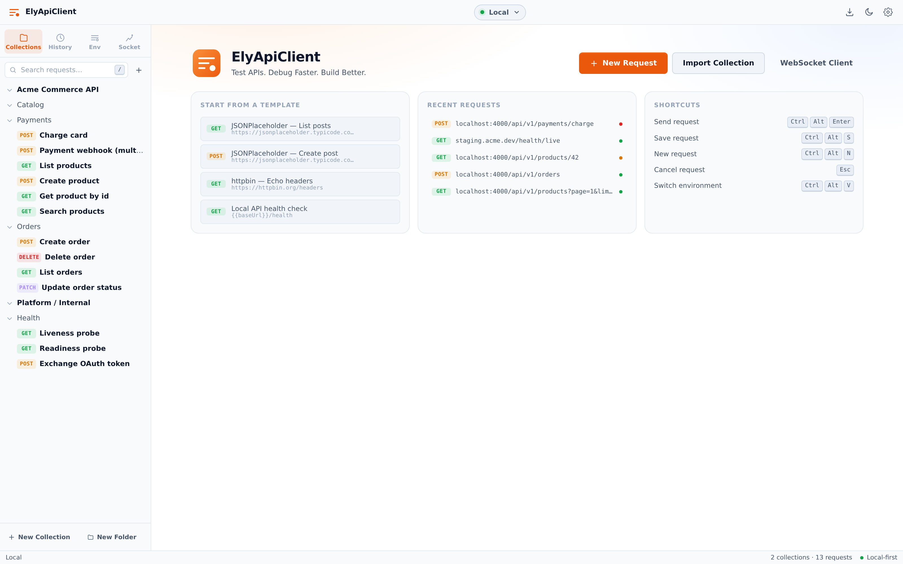
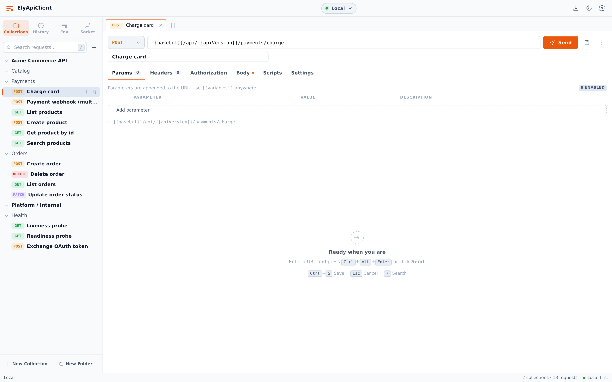
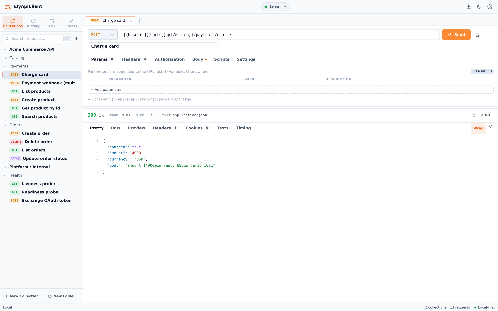
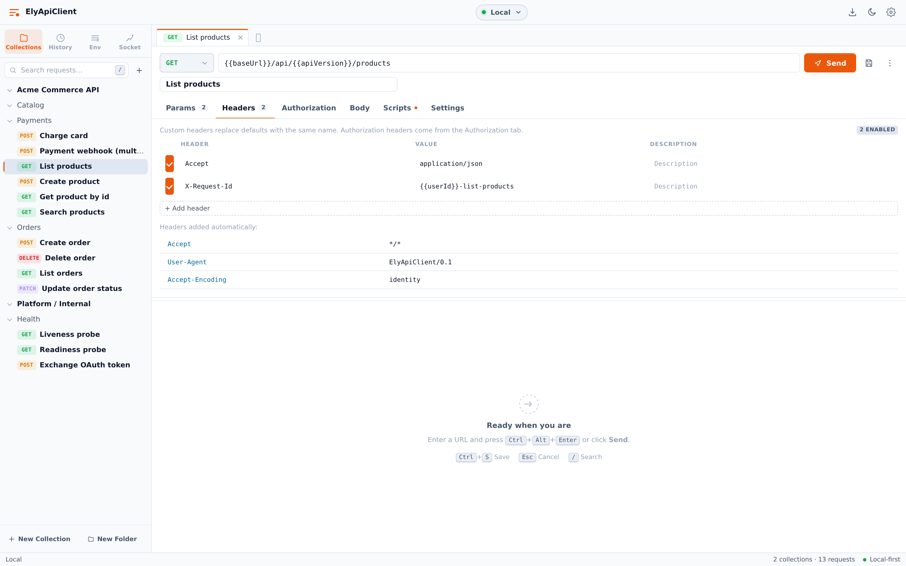
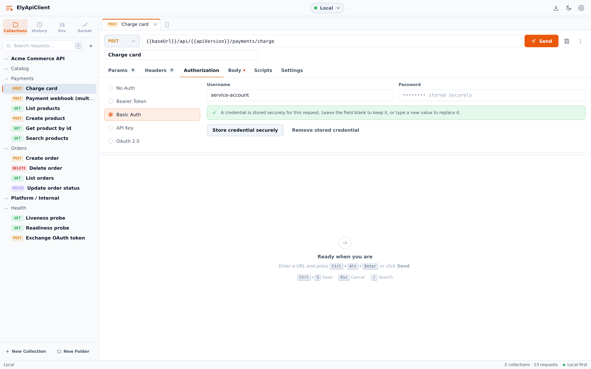
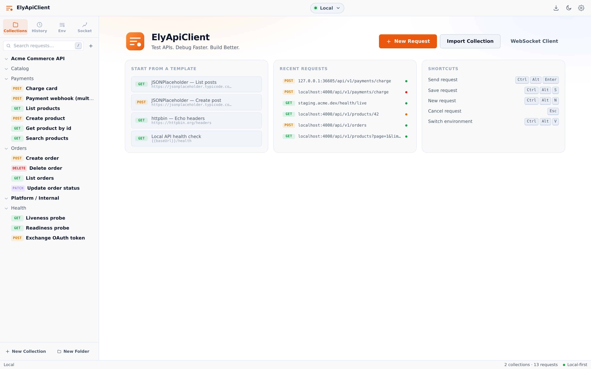
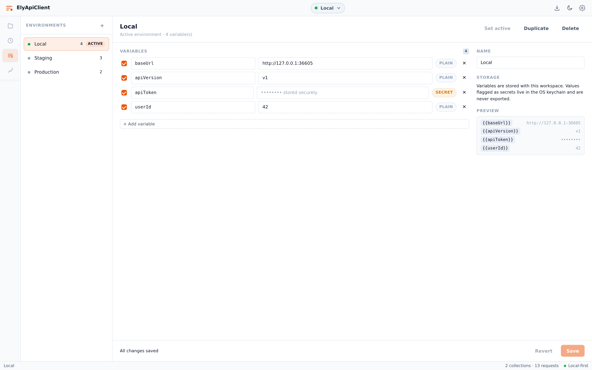
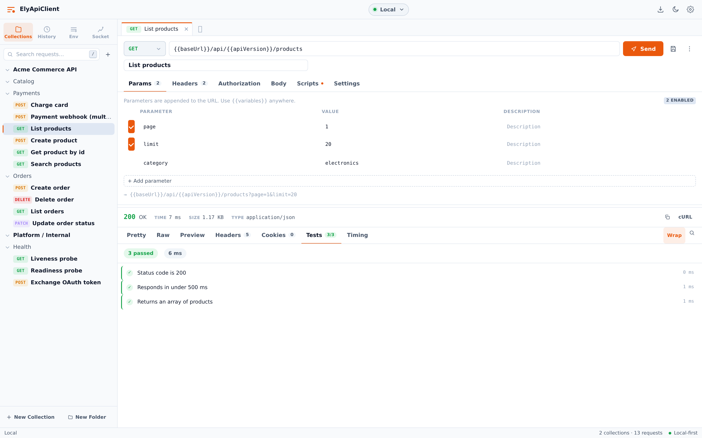
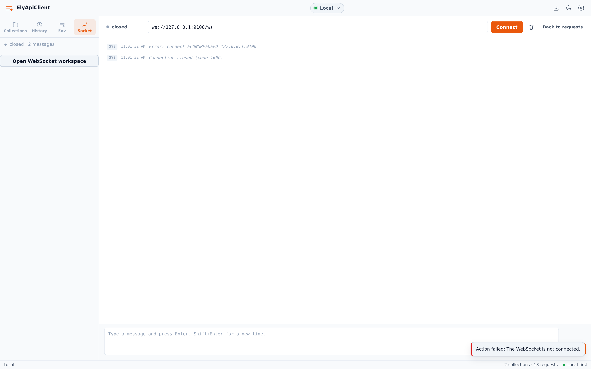
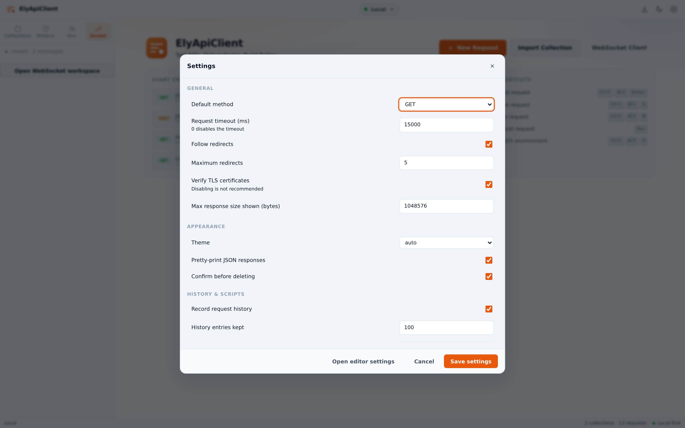

# ElyApiClient

**Test APIs. Debug Faster. Build Better.**

A modern, local-first REST & WebSocket API client for Visual Studio Code. Send requests, inspect
responses, organise collections, manage environments, write automated tests and stream WebSocket
messages — without leaving your editor, and without an account or a cloud sync.



## Why ElyApiClient

- **Local-first.** Collections, environments and history live on your machine (workspace or global
  scope, your choice). Secrets go to the OS keychain through VS Code's `SecretStorage`.
- **No account, no telemetry, no paid tier.** The extension is MIT licensed and works offline.
- **The real thing.** Requests are executed by the extension host with Node's HTTP stack, so
  response bodies, headers, timing, redirects and errors are genuine — never simulated.
- **Editor-native.** Sidebar explorer, command palette commands, keybindings and theme integration
  alongside a full client UI in a webview panel.

## Features

### 1. Main dashboard and sidebar

The landing page surfaces templates for common endpoints, recent requests with status indicators and
the active keyboard shortcuts. The left rail switches between **Collections**, **History**,
**Environments** and the **WebSocket** tool.

### 2. HTTP request builder

Every method (`GET`, `POST`, `PUT`, `PATCH`, `DELETE`, `HEAD`, `OPTIONS`) with a URL bar that
resolves `{{variables}}` as you type, a live resolved-URL preview, and a per-request name.



- Multi-tab documents with dirty-state indicators
- Duplicate, save, close and delete from the tab menu
- `Ctrl+Alt+Enter` to send, `Ctrl+Alt+S` to save, `Ctrl+Alt+N` for a new request

### 3. API response viewer

Status, duration, size and content type at a glance, then seven views over the same response:

| View | What it shows |
| ---- | ------------- |
| **Pretty** | Syntax-highlighted JSON/XML/HTML with line numbers and optional wrapping |
| **Raw** | The exact bytes received |
| **Preview** | Rendered HTML, images and binary previews (sanitised, no scripts) |
| **Headers** | Every response header, maskable |
| **Cookies** | Parsed `Set-Cookie` values with attributes |
| **Tests** | Passed/failed assertions from the request's test script |
| **Timing** | Connect, first byte and download phases |



Errors are categorised — DNS, TLS, timeout, refused, blocked address, too large — with a hint that
says what to change.

### 4. Headers and query parameters

Enable, disable, add and reorder key/value rows. Disabled rows are remembered but not sent, and
disabling a parameter that is also present in the URL removes it from the final request.



### 5. Authentication

No auth, Bearer token, Basic auth, API key (header or query) and OAuth 2.0 (client credentials).
Credentials can be stored in the OS keychain and are **masked in the UI and in exports** — the
webview never receives a stored secret back.



### 6. Collections and folders

Nested collections, folders and requests with drag-free organisation, inline rename, duplicate,
move, delete (with confirmation), and search across the tree. The footer keeps **+ New Collection**
and **+ New Folder** one click away — the folder lands in whichever collection or folder is selected,
so organising never means hunting through a context menu.



- Import Postman v2.1, OpenAPI 3 and cURL
- Export JSON, sanitised by default (secrets removed)
- Collection-level variables, headers and inherited test scripts

### 7. Environment manager

A master-detail editor: environments on the left, the selected environment's variables on the right,
with a live `{{variable}}` preview, per-variable secret flags and "Set active" / "Duplicate" /
"Delete" actions. Edits are held as a draft until **Save**, so you can't lose work by switching
environments, and **Revert** restores the stored values. Quick switching is also available from the
title bar or `Ctrl+Alt+V`. While the manager is open the explorer collapses to a slim icon rail, so
every other section stays one click away instead of the manager trapping you in its own view.



The variable resolution order is:

```
runtime (scripts)  →  active environment  →  collection variables
```

Unresolved variables are highlighted before the request is sent, not after it fails.

### 8. Automated API testing

Test scripts run in an isolated `node:vm` sandbox with a Postman-compatible API:

```js
pm.test('status is 200', () => {
  pm.expect(pm.response.code).to.equal(200);
});

pm.test('returns an array of products', () => {
  const body = pm.response.json();
  pm.expect(body.items).to.be.an('array');
  pm.expect(body.items.length).to.be.above(0);
});
```



Supported: `pm.test`, `pm.expect` (chai subset incl. `to.be.an.array`, `.not`, `include`, `property`,
`above`/`below`), `pm.response`, `pm.request`, `pm.environment`, `pm.collectionVariables`,
`pm.variables`, `pm.cookies`, console capture, and pre-request scripts. Scripts are time-limited,
memory-limited and cannot import modules or touch the network.

### 9. WebSocket testing

Connect to any `ws://` or `wss://` endpoint, send and receive frames with timestamps, and inspect the
log. Messages are capped by a configurable buffer.



### 10. Settings and preferences

General, appearance and history/script settings in one dialog, written back to VS Code settings so
they also apply in the command palette and sync with Settings Sync.



Everything here maps to a documented `elyApiClient.*` setting (timeouts, redirects, TLS
verification, response size limits, history retention, script limits, WebSocket limits, theme and
storage scope).

## Security model

ElyApiClient is designed for a hostile response payload and untrusted imports.

| Area | Control |
| ---- | ------- |
| Credentials | OS keychain via `SecretStorage`; masked in messages, exports and logs |
| Response rendering | Bodies are inserted with `textContent`; HTML preview is sanitised and never executes scripts |
| Request targets | Protocol allow-list (`http`/`https`), optional private-network blocking with a trusted-host list, DNS re-resolution before connecting |
| Headers | CRLF and NUL rejected (header injection), length limits |
| Scripts | `node:vm` with no `require`, no network, execution timeout and memory cap |
| Imports | Size limits, schema validation, no script auto-execution on import |
| Message bus | Every inbound webview message validated against a schema before dispatch |
| TLS | Certificate verification on by default |

## Getting started

### From source

```bash
git clone https://github.com/elyseprodev/Ely-Api-Client.git
cd Ely-Api-Client
npm install
npm run compile
```

Then press <kbd>F5</kbd> in VS Code to launch the Extension Development Host, or run
`npx vsce package` (or `npm run vsix`) and install the generated `.vsix`.

### Try the UI without VS Code

A browser harness runs the *real* client core (not a mock) against a local demo API:

```bash
npm run compile
npm run harness           # http://localhost:4173
```

It seeds a sample collection, environments and history, starts an in-process HTTP + WebSocket mock
server, and bridges the webview over HTTP. Useful for UI work and for generating the screenshots in
this README.

## Commands

| Command | Description |
| ------- | ----------- |
| `ElyApiClient: Open Client` | Open the client panel |
| `ElyApiClient: New Request` | Create a scratch request |
| `ElyApiClient: Send Request` | Send the active request |
| `ElyApiClient: Save Request` | Save the active request |
| `ElyApiClient: New Collection` / `New Folder` | Organise requests |
| `ElyApiClient: New Environment` | Create an environment |
| `ElyApiClient: Import Collection` | Import Postman / OpenAPI / cURL |
| `ElyApiClient: Export Collection` | Export as sanitised JSON |
| `ElyApiClient: Clear History` | Delete request history |
| `ElyApiClient: Open WebSocket Client` | Open the WebSocket workspace |
| `ElyApiClient: Open Client Settings` | Open settings |

## Configuration

All settings live under `elyApiClient.` and are documented in the Settings UI and in
`package.json`. The most relevant:

| Setting | Default | Purpose |
| ------- | ------- | ------- |
| `http.timeout` | `30000` | Request timeout in ms (`0` disables) |
| `http.followRedirects` | `follow` | `follow` or `never` |
| `http.verifyTls` | `true` | Certificate verification |
| `http.maxResponseSize` | `10485760` | Reject larger responses (bytes) |
| `response.maxDisplaySize` | `1048576` | Body bytes sent to the UI |
| `request.defaultMethod` | `GET` | Method for new requests |
| `history.limit` | `100` | Entries kept (`0` = unlimited) |
| `security.allowPrivateNetwork` | `true` | Allow loopback/private targets |
| `security.confirmBeforeDelete` | `true` | Confirm destructive actions |
| `testing.timeoutMs` | `3000` | Script execution limit |
| `ui.theme` | `auto` | `auto`, `light` or `dark` |
| `storage.scope` | `workspace` | `workspace` or `global` |

## Development

```bash
npm run compile       # type-check + build to out/ (also verifies webview assets)
npm run typecheck     # tsc --noEmit for src and tests
npm run lint          # eslint
npm test              # compile + vitest (unit + integration against the mock API)
npm run harness       # browser UI harness
npm run screenshots   # regenerate docs/screenshots
npm run vsix          # package the extension
```

### Architecture

```
src/
  extension.ts              activation, command registration
  services/
    AppCore.ts              framework-independent core: services + webview message protocol
    ExtensionController.ts  thin VS Code subclass (dialogs, files, clipboard, settings)
    HttpClient.ts           HTTP with TLS/limits/redirects/timing
    RequestExecutionService variable resolution → auth → body → network → tests
    CollectionService.ts    collections, folders, requests, variables
    EnvironmentService.ts   environments + secrets
    HistoryService.ts       bounded, redacted request history
    WebSocketService.ts     connection lifecycle + message log
    ImportExportService.ts  Postman / OpenAPI / cURL in, sanitised JSON out
  scripting/                node:vm sandbox, Postman-compatible `pm` API, worker host
  security/                 sanitisation, redaction, validators
  utils/                    URL validation/building, variable resolution, JSON
  providers/                tree view + sidebar webview providers
media/                      webview HTML/CSS/JS (no framework, no build step)
test/                       vitest unit + integration suites
scripts/                    build, UI harness, screenshot generator
```

`AppCore` depends on no VS Code API: the editor subclass supplies dialogs and persistence, while the
harness and tests instantiate the core directly in plain Node. That is what makes the integration
tests exercise the same code path the extension uses.

## Limitations

Being explicit about what is **not** implemented yet:

- GraphQL-specific tooling (schema introspection, variable forms) — the `graphql` body type works,
  but there is no schema-aware editor.
- Collection runner / CI integration — tests run per request, not as a folder suite.
- gRPC, SSE and MQTT protocols.
- Cookie jar persistence between requests (cookies are displayed per response, not replayed).
- Syncing collections across machines (local-first by design; export/import is the transfer path).

## License

[MIT](LICENSE)

## Verified behaviour

The following flows are covered by automated tests and were verified against the running webview:

| Flow | Verified by |
| ---- | ----------- |
| GET/POST/PUT with headers, params and JSON bodies | `test/integration/http.test.ts` |
| Variable resolution from the active environment | `test/integration/http.test.ts` |
| Blocked private addresses when disabled | `test/integration/http.test.ts` |
| HTTP error statuses surfaced without throwing | `test/integration/http.test.ts` |
| `pm.test` / `pm.expect` chains incl. `to.be.an.array` | `test/unit/assertions.test.ts` |
| Gzip decoding, redirect chains, response timing | `test/integration/http.test.ts` |
| Postman / OpenAPI / cURL import, sanitised export | `test/integration/import.test.ts` |
| Collection, folder and request lifecycle | `test/integration/import.test.ts` |
| History recording and clearing | `test/integration/import.test.ts` |
| URL validation, protocol and host policy | `test/unit/url.test.ts` |
| Secret redaction and header masking | `test/unit/security.test.ts` |
| New request → send → close tab → welcome state | UI harness (manual + screenshots) |
| WebSocket connect, echo round-trip, log | UI harness (manual + screenshots) |
| Settings persistence from the dialog | UI harness (manual) |
| Bearer, Basic, API-key (header and query) auth | `test/integration/auth.test.ts` |
| OAuth2 client-credentials exchanged exactly once | `test/integration/auth.test.ts` |
| Failed token exchange reported, request not sent | `test/integration/auth.test.ts` |
